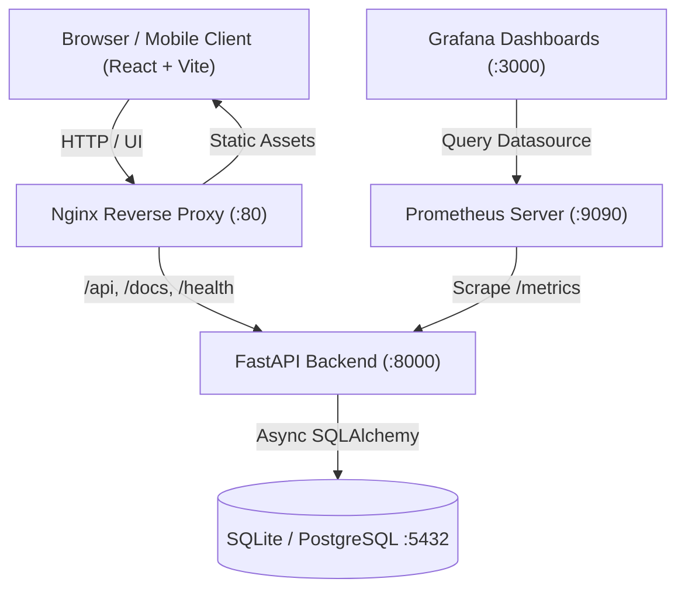
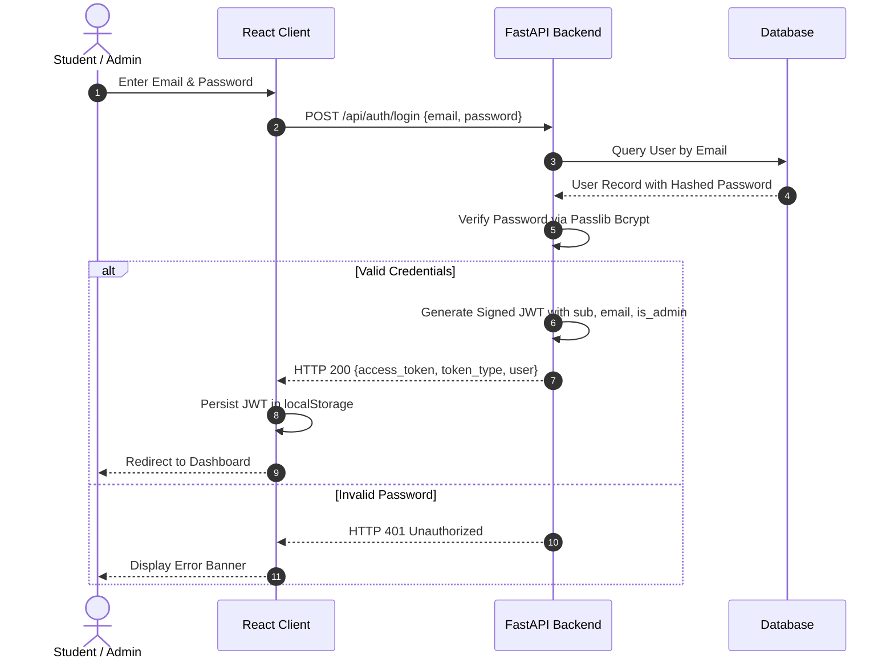
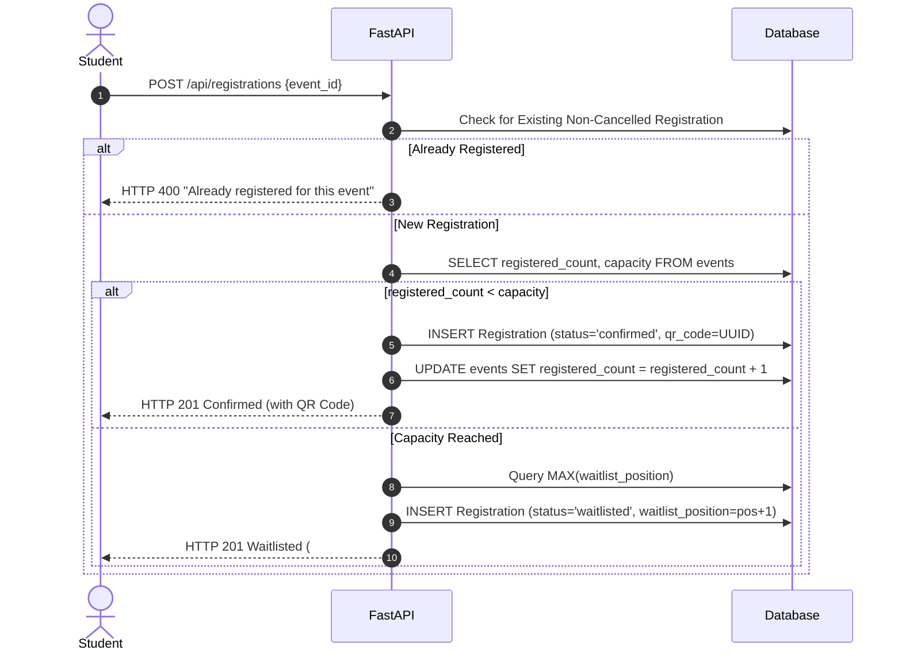
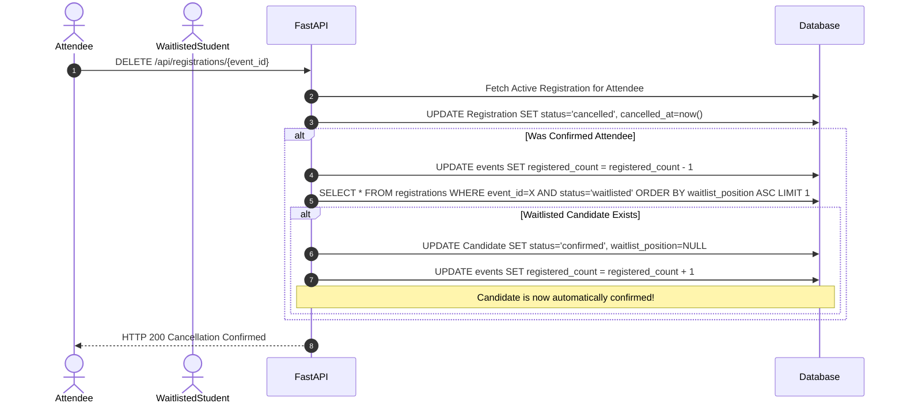
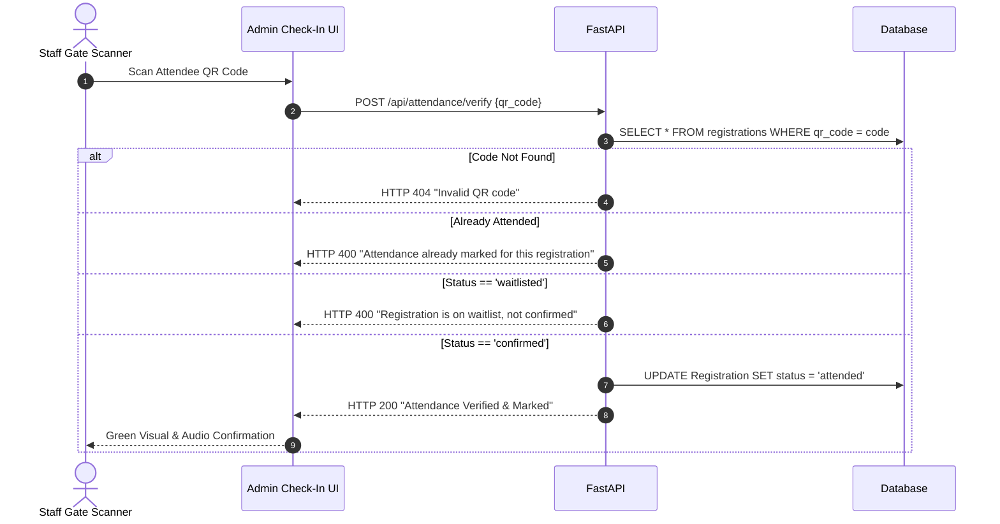

# CampusConnect — Architecture Specification

## 1. System Overview
CampusConnect follows a decoupled client-server architecture with an asynchronous REST API backend, a reactive single-page frontend (SPA), a relational persistence layer, and optional telemetry monitoring.

---

## 2. High-Level Component Diagram

---

## 3. Authentication & Authorization Sequence

---

## 4. Registration & Automated Waitlist Flow

---

## 5. Waitlist Promotion on Cancellation

---

## 6. Gate QR Verification Flow

